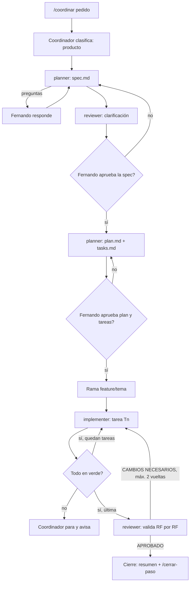
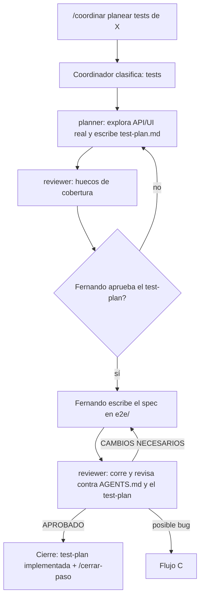
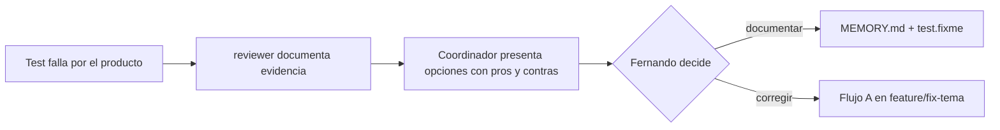

# Guía del sistema multiagente (Cursor)

Cómo trabajar en **ecommerce-bike** con un coordinador y tres subagentes: quién hace qué, cómo se invocan y qué flujo sigue cada pedido.
Basado en los apuntes del curso (Día 3, "Multiagentes y subagentes"), adaptado de OpenCode a Cursor y a las reglas de [`AGENTS.md`](../AGENTS.md).

> Regla de oro: la IA ejecuta, pero el responsable del proyecto sos vos. Ningún agente aprueba specs, hace commit, push ni PR por su cuenta.

## 1. Las piezas

| Pieza | Tipo en Cursor | Archivo | Rol |
|-------|----------------|---------|-----|
| **Coordinador** | Agente principal (el chat) + skill + comando | `.cursor/skills/ebike-coordinator/SKILL.md`, `.cursor/commands/coordinar.md` | Clasifica el pedido, reparte fases, pasa contexto, te pide aprobación |
| **planner** | Subagente | `.cursor/agents/planner.md` | Escribe `spec.md`, `plan.md`, `tasks.md` o `test-plan.md`. Solo edita `specs/` |
| **implementer** | Subagente | `.cursor/agents/implementer.md` | Implementa **una** tarea del plan y corre la verificación (modo producto) |
| **reviewer** | Subagente | `.cursor/agents/reviewer.md` | Revisa specs como QA, valida RF por RF y revisa tus tests. No edita nada |
| **ebike-sdd** | Skill | `.cursor/skills/ebike-sdd/SKILL.md` | Plantillas de specs (EARS), planes, tareas y test-plans |

Las skills de producto que ya existían (`ebike-feature-workflow`, `ebike-forms`, `ebike-auth-ux`, `ebike-homepage`, `ebike-catalog-cart`) las siguen usando el planner y el implementer.

### De OpenCode a Cursor

| En el curso (OpenCode) | En este proyecto (Cursor) | Diferencia |
|------------------------|---------------------------|------------|
| `.opencode/agents/coordinator.md` con `mode: primary` | Chat principal + skill `ebike-coordinator` + `/coordinar` | Cursor no tiene agentes principales personalizados: el chat principal adopta el rol al leer la skill |
| `.opencode/agents/<x>.md` con `mode: subagent` | `.cursor/agents/<x>.md` | Mismo concepto. Frontmatter: `name`, `description`, `model`, `readonly`, `is_background` |
| `permissions` por acción y ruta (`edit specs/** allow`) | `readonly: true/false` + reglas escritas en el prompt | Cursor no tiene permisos por ruta. Ver sección 7 |
| `node --test` | `npm run test:api`, `npm run test:ui`, Vitest, `pytest -m integration` | Suites del proyecto |
| `docs/constitution.md` | `AGENTS.md` + decisiones de `MEMORY.md` + skills `ebike-*` | Ya existían; no se duplica |
| MCP de Chrome DevTools | Navegador de Cursor o MCP de Playwright | Para verificar UI y vista móvil |
| Agentes por defecto: `build`, `plan`, `general`, `explore` | Modo Agent, modo Plan, subagentes `generalPurpose` y `explore` | Siguen disponibles para consultas sueltas |

## 2. Estructura

```text
ecommerce-bike/
├── AGENTS.md, MEMORY.md
├── docs/GUIA_AGENTES.md          ← esta guía
├── specs/                        ← la crea el planner con la primera petición
│   └── NNN-nombre/
│       ├── spec.md               (producto)
│       ├── plan.md               (producto)
│       ├── tasks.md              (producto)
│       └── test-plan.md          (tests)
└── .cursor/
    ├── agents/
    │   ├── planner.md
    │   ├── implementer.md
    │   └── reviewer.md
    ├── skills/
    │   ├── ebike-coordinator/    ← rol del coordinador
    │   ├── ebike-sdd/            ← plantillas
    │   └── ebike-*/              ← skills de producto existentes
    └── commands/
        ├── coordinar.md          ← punto de entrada del flujo
        └── iniciar-sesion.md, planear-tests.md, revisar-test.md, mejorar-pantalla.md, cerrar-paso.md
```

## 3. Cómo se invocan

| Querés… | Escribí en el chat (modo Agent) |
|---------|--------------------------------|
| Arrancar el flujo completo | `/coordinar <pedido>` |
| Que el chat actúe como coordinador sin el comando | `Seguí el flujo SDD con la skill ebike-coordinator: <pedido>` |
| Llamar a un subagente suelto | `/planner ...`, `/reviewer ...`, `/implementer ...` o en lenguaje natural: `Usá el subagente reviewer para revisar e2e/tests/api/cart-items.spec.ts` |
| Varios en paralelo | `Lanzá en paralelo tres reviewer sobre specs/002-..., cada uno con un foco distinto: ...` |
| Ver qué hace cada subagente | Desplegá el bloque del subagente en el chat mientras trabaja |

Notas:

- Si los subagentes no aparecen al escribir `/`, recargá la ventana de Cursor (`Ctrl+Shift+P` → "Developer: Reload Window").
- Los subagentes **no ven la conversación**. Cuando los llamás sueltos, decí todo: modo, rutas a leer y qué querés de vuelta. El coordinador lo hace solo con la plantilla de contexto de su skill.
- El chat principal tiene que estar en **modo Agent** (en modo Plan o Ask no puede delegar ni ejecutar).

## 4. Qué hace cada uno cuando hacés un pedido

| Fase | Coordinador | planner | implementer | reviewer | Vos |
|------|-------------|---------|-------------|----------|-----|
| Clasificar | Lee `MEMORY.md`, elige flujo y te lo dice | — | — | — | Corregís si eligió mal |
| Spec / test-plan | Le pasa tu pedido literal | Redacta en `specs/` o te devuelve preguntas | — | — | Respondés preguntas |
| Clarificación | Te muestra el informe | Corrige si hace falta | — | Busca ambigüedades, contradicciones, límites | **Aprobás** |
| Plan + tareas (producto) | Te resume | Escribe `plan.md` y `tasks.md` | — | — | **Aprobás** |
| Implementación (producto) | Una llamada por tarea, controla el verde | — | Implementa T*n*, corre suites, marca `[x]` | — | Mirás el avance |
| Escribir tests (tests) | Te explica y responde dudas | — | Solo si lo pedís explícitamente | — | **Escribís el spec** |
| Validación / revisión | Te muestra el veredicto | — | Corrige la lista exacta (máx. 2 vueltas) | `VEREDICTO: APROBADO` o `CAMBIOS NECESARIOS` | Decidís |
| Cierre | Resume y sugiere `/cerrar-paso` | — | — | — | Commit, push y PR cuando quieras |

## 5. Flujos

### A. Producto (SDD completo)

Para mejoras o funcionalidades nuevas de la app (rama `feature/<tema>`).



### B. Tests (modo mentor)

Para el roadmap de QA Automation. **Vos escribís los tests**; los agentes planifican y revisan (rama `test/<bloque>` o `practice/<bloque>`).



### C. Bug encontrado por un test



### Cuándo NO usar el flujo

Cambios chicos (un texto, un estilo, un fix de un archivo) o preguntas puntuales: pedilo directo o usá los comandos de siempre (`/mejorar-pantalla`, `/planear-tests`, `/revisar-test`). El coordinador te lo va a sugerir si mandás algo chico por `/coordinar`.

## 6. Ejemplos de pedidos

**Producto**

```text
/coordinar Quiero que el catálogo guarde los filtros en la URL y que las tarjetas muestren "Sin stock" cuando stock = 0.
```

**Tests**

```text
/coordinar Planear los tests de API del carrito: agregar, modificar y borrar ítems, y errores de stock. Los escribo yo.
```

```text
/coordinar Ya escribí e2e/tests/api/cart-items.spec.ts siguiendo specs/001-cart-items-api/test-plan.md. Revisalo.
```

**Revisión en paralelo**

```text
Lanzá en paralelo tres reviewer sobre specs/002-filtros-catalogo, cada uno con un foco distinto:
1. Reglas de AGENTS.md y decisiones de MEMORY.md.
2. Interfaz: accesibilidad, nombres accesibles que usan los specs de e2e y vista móvil.
3. Tests: qué RF están cubiertos por Vitest/pytest/e2e y cuáles no.
Cuando terminen, juntá los resultados en un único informe sin duplicados y con un veredicto final.
```

**Subagente suelto**

```text
/reviewer Modo tests. Revisá e2e/tests/ui/login.spec.ts contra AGENTS.md. Devolvé veredicto y mejoras.
```

## 7. Permisos y límites

Cursor no permite restringir permisos por ruta o por comando como OpenCode. Por eso:

| Subagente | `readonly` | Por qué |
|-----------|------------|---------|
| planner | `false` | Tiene que escribir en `specs/`. Su prompt le prohíbe editar fuera de esa carpeta |
| implementer | `false` | Edita código y corre suites |
| reviewer | `false` | Tiene que **correr tests**, y `readonly: true` bloquea comandos que escriben (Playwright genera `test-results/`). Su prompt le prohíbe editar archivos |

Si querés una garantía más fuerte que el prompt, el siguiente paso es un **hook** de Cursor (`.cursor/hooks.json`) que rechace ediciones del planner fuera de `specs/` o cualquier edición del reviewer. Queda como mejora opcional; no está configurado.

Otros límites a tener en cuenta:

- Los subagentes no lanzan otros subagentes: solo el coordinador delega.
- Cada llamada a un subagente arranca de cero: el contexto que no se le pasa, no existe.
- Todos usan `model: inherit` (el modelo del chat). Se puede cambiar por subagente en su frontmatter, por ejemplo un modelo distinto para el reviewer, así no revisa el mismo modelo que implementó.
- Más subagentes = más consumo. Para cosas chicas, el flujo completo no compensa.

## 8. Relación con los comandos existentes

| Comando | Sigue sirviendo para | Con el sistema multiagente |
|---------|---------------------|----------------------------|
| `/iniciar-sesion` | Verificar entorno y rama | Usalo antes de `/coordinar` |
| `/planear-tests` | Tabla de casos rápida en el chat | Versión "pesada": flujo B, queda en `test-plan.md` |
| `/revisar-test` | Revisión rápida de un spec | Equivale al `reviewer` en modo tests |
| `/mejorar-pantalla` | Mejoras chicas de producto | Para mejoras grandes, flujo A |
| `/cerrar-paso` | Suites, commits y `MEMORY.md` | Es el cierre de los flujos A y B |

## 9. Sesión típica

1. `/iniciar-sesion` → entorno arriba, rama correcta.
2. `/coordinar <pedido>` → el coordinador dice qué flujo usa.
3. Aprobás spec / test-plan y, en producto, plan + tareas.
4. Implementan (producto) o escribís el spec (tests); el reviewer valida.
5. `/cerrar-paso` → commits propuestos, `MEMORY.md` actualizado.
6. Push y PR cuando vos lo confirmes.

## 10. Problemas comunes

| Síntoma | Causa probable | Qué hacer |
|---------|---------------|-----------|
| `/planner` no aparece | Cursor no recargó `.cursor/agents/` | Reload Window |
| El subagente pregunta cosas obvias o inventa | El coordinador no le pasó el contexto | Pedile al coordinador que repita la llamada con la plantilla de contexto completa |
| El reviewer "arregló" algo | Ignoró su prompt (no hay permisos duros) | Revertilo con `git diff` / `git restore` y evaluá el hook de la sección 7 |
| El implementer hizo dos tareas juntas | Pedido demasiado amplio | Pedir "solo T*n*" explícitamente |
| Los tests de UI fallan en la validación | Front o API caídos | `/iniciar-sesion` o `.\scripts\iniciar-dev.ps1` |
